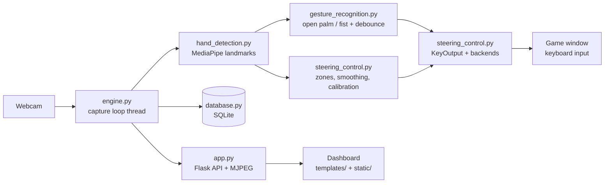

# Hand Gesture Steering Controller

Play keyboard-controlled PC racing games (Traffic Racer-style games, Euro Truck Simulator 2, browser racers)
with your hand in front of a webcam. A Flask dashboard shows the live camera, the hand skeleton, a virtual
steering wheel and the current controls.

## Features

- Real-time hand tracking with MediaPipe (single hand)
- **Move hand left / right** = steer left / right, with a configurable dead zone, smoothing and hysteresis
- **Open palm** = accelerate, **closed fist** = brake (the two gestures can be swapped in the UI)
- **No hand** = every key is released
- Calibration button to set your neutral hand position
- Pulse-width steering: a small movement taps the key briefly, a big movement holds it
- Dark dashboard: live preview, virtual wheel, gesture/direction/gas/brake indicators, camera status, FPS,
  sensitivity and dead-zone sliders, session history
- SQLite storage of settings and session summaries (no video frames are stored)
- Safe key handling: keys are released on stop, on camera loss, on errors, on exit, and by a mouse-corner failsafe
- "Send keys" checkbox so you can test tracking without touching the game

## Architecture



```
hand-gesture-steering-controller/
├── app.py                  Flask server, REST API, video stream
├── engine.py               capture/processing thread, status, safe shutdown
├── hand_detection.py       MediaPipe Tasks hand landmarker, drawing
├── gesture_recognition.py  open palm / fist classifier + debouncing
├── steering_control.py     steering logic, key output, keyboard backends, failsafe
├── database.py             SQLite: Users, Settings, Game_Sessions
├── config.py               all tunable defaults
├── requirements.txt
├── database/               SQLite file is created here
├── models/                 hand model is downloaded here on first run
├── templates/index.html    dashboard
├── static/css, static/js   dashboard styling and logic
└── tests/                  pytest suite
```

## Technology stack

Python, OpenCV, MediaPipe (Tasks API), NumPy, Flask, SQLite, HTML/CSS/JavaScript.
Keyboard output uses **pydirectinput** (hardware scan codes, works in many games) with **PyAutoGUI** as a fallback.

## Installation (Windows)

1. Install Python 3.10 – 3.12 (a newer version works only if MediaPipe supports it).
2. Open a terminal in the project folder and create an environment:
   ```
   python -m venv venv
   venv\Scripts\activate
   python -m pip install -r requirements.txt
   ```
3. The first start downloads the hand model (about 8 MB) into `models/`. If the download fails, save
   <https://storage.googleapis.com/mediapipe-models/hand_landmarker/hand_landmarker/float16/1/hand_landmarker.task>
   as `models/hand_landmarker.task`.

## Run

```
python app.py
```

Open <http://127.0.0.1:5000>.

Many games ignore keys from a normal program. If the game does not react, close the terminal/VS Code and
start it with **Run as administrator**, run the game in **windowed or borderless** mode, and make sure the
game window has focus.

## Using it

1. Press **Start** (tick *Send keys* off first if you only want to test tracking).
2. Hold one hand up in front of the camera, centred, and press **Calibrate**.
3. Move your hand left/right to steer. Open palm = gas, fist = brake.
4. Pick the key set that matches your game (**WASD** or **ARROWS**), set the game name, then click the game
   window so it has focus.
5. Press **Stop** when you finish. The session summary is saved.

**Failsafe:** move the mouse pointer to the top-left corner of the screen to stop the controller immediately.

## Configuration

Defaults live in `config.py` (camera index, resolution, smoothing, dead zone, hysteresis, key sets, port).
Sensitivity, dead zone and the two gestures can also be changed in the dashboard and are saved per user.
The database has one `default` user; the schema supports more.

## Tests

```
python -m pytest
```

The suite covers gesture classification, left/right steering, acceleration, braking, calibration, database
operations, safe stopping (including camera loss and the failsafe), settings validation and the HTTP API,
using a fake camera and a recording keyboard. Detecting a real hand and driving a real game need a webcam
and the game, so check those by running the app.

## Future improvements

- Virtual gamepad output (analog steering) for games that ignore keyboard input
- Two-hand "steering wheel" mode using the tilt between both hands
- Gestures for nitro, horn, handbrake
- Multiple user profiles in the dashboard
- Per-game key profiles saved in the database
- Packaged Windows executable

## Two-hand virtual steering wheel

The controller now supports a two-hand steering mode. MediaPipe is configured to
track up to two hands. When both hands are visible, the engine calculates the angle
of the line joining their palm centres. Press **Calibrate** while holding both hands
level in the straight-ahead position; subsequent angle changes are mapped to left
and right steering through the existing smoothing, dead-zone and keyboard-output
logic. Keep both hands visible and approximately the same distance from the camera.

The existing open-palm / fist gesture configuration is still used for acceleration
and braking. Depending on how you pose your hands, you may need to adjust these
gestures or use a separate input for throttle/brake so that a natural wheel-holding
pose is not mistaken for braking. This remains a PC game input demo, not a real
vehicle controller.
